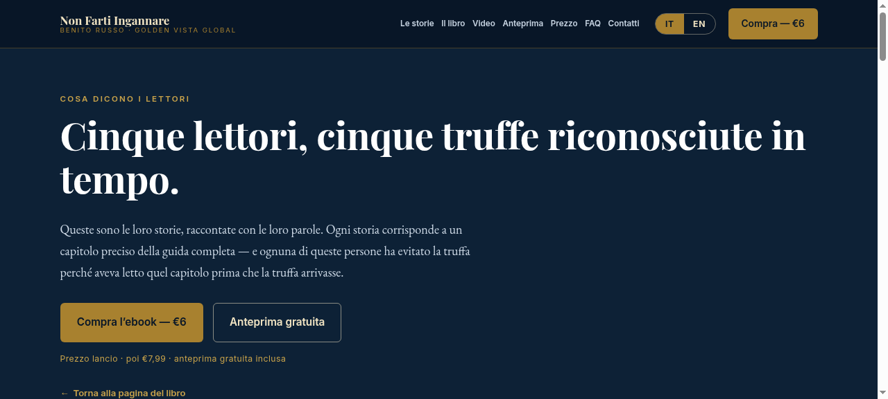

# Non Farti Ingannare — Bilingual Anti-Fraud Guide

A bilingual (Italian / English) guide to online scams — chapter index, red-flag library and downloadable resources.

**[→ View the live site](https://ebubechineka.github.io/ITALIAN-SCAM-PREVENTION/)**



## What this is

A book sales site and reference guide for an Italian-language anti-fraud book, with a full English toggle. The audience is often not confident online — which is exactly the audience most targeted by scams — so the design had to be plain, calm and impossible to get lost in.

The chapter index, red-flag library and downloadable checklists are all reachable in one tap from the top of the page.

## What's inside

- Bilingual Italian / English with a language toggle
- Full chapter index
- Red-flag library
- Downloadable resources
- 100% static — no build step, no server, no database

## Technology

- HTML, CSS and JavaScript
- Static site — no build step required
- Deployed on GitHub Pages

## Run it locally

No build step, no dependencies — it's plain HTML, CSS and JavaScript.

```bash
# from the repository root
python3 -m http.server 8000
# then open http://localhost:8000
```

Or just open `index.html` directly in a browser.


---

<sub>Built by **[Benito K Chukwuemeka](https://github.com/Ebubechineka)** · [Golden Vista Global](https://ebubechineka.github.io/golden-vista-global/) — business websites, landing pages and web apps for clients in Nigeria and worldwide.</sub>
